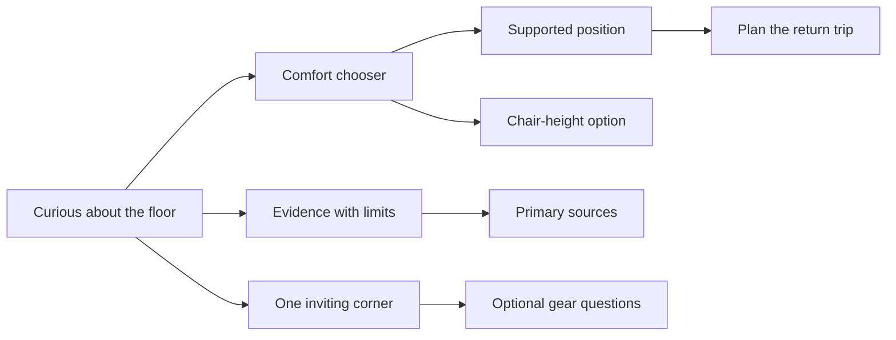

# Floor Life: ground-level delight and evidence

Reviewed October 10, 2026. Reference: the warmth, curiosity, visual character, and useful interactions of deadbutt.fyi. Floor Life keeps its own cream, sage, clay, Fraunces, and quiet room-design identity.

## Audit and implementation

- [x] Fetch and fast-forward clean `main` to `f7af895`; retain the newly published mobility guide and product category.
- [x] Audit every route, all six positions, all five journal pieces, all 16 product examples, shared components, and research descriptions.
- [x] Replace the mortality-led landing pitch with a friendly cushion illustration, editorial introduction, practical entry points, FAQs, and a four-way comfort chooser.
- [x] Add a chair-height path, supported-transfer guidance, symptoms that warrant stopping, and adaptations without flexibility or gender-based prescriptions.
- [x] Rebuild the evidence page around study design, population, findings, limits, and near-claim source links.
- [x] Remove unsupported longevity promises, claims that chairs necessarily cause lost range, harmless-numbness advice, universal joint precautions, and definite fascia/posture mechanisms.
- [x] Preserve the Sitting–Rising Test feature as an educational sandbox; correct per-phase unsteadiness and minimum scores, and remove personal health classifications.
- [x] Preserve product examples and comparison routes while removing unsourced star ratings, prices, tiers, superiority claims, and invented testing impressions.
- [x] Retain all five substantive journal routes, including the mobility kit's equipment options; correct the claims and add contextual sources.
- [x] Replace the unbacked email-to-`hello@floor.life` signup with the site's working RSS feed and journal links.
- [x] Improve muted-text contrast, visible form focus, reading rhythm, article print visibility, no-storage theme behavior, and timezone-stable editorial dates.
- [x] Complete the source/build/link checks below and hand off browser review and serial publication to the parent agent. No push or deployment performed.

## Reader journey



## Research ledger

The clinical material is educational, not an individual assessment. Guidance distinguishes activity breaks, resting positions, fitness markers, and training effects. Primary source records and clinical guidance were opened during this audit; reviews are explicitly labelled as reviews.

| Source | Use and boundary |
| --- | --- |
| [Dunstan et al., 2012](https://pubmed.ncbi.nlm.nih.gov/22374636/) | Short walking breaks and acute metabolic responses; not a floor-sitting trial or universal schedule. |
| [Raichlen et al., 2020](https://pmc.ncbi.nlm.nih.gov/articles/PMC7132251/) | Position-specific lower-leg activity in Hadza adults; no claim that all ground sitting increases activation or prevents disease. |
| [de Brito et al., online 2012 / issue 2014](https://pubmed.ncbi.nlm.nih.gov/23242910/) | SRT cohort; association, not a treatment effect or individual prognosis. |
| [Araújo et al., online 2025 / issue 2026](https://pubmed.ncbi.nlm.nih.gov/40569873/) | Later cohort and published per-phase scoring; no personalized risk categories. |
| [Zhang et al., 2004](https://pubmed.ncbi.nlm.nih.gov/15077301/) | Squatting exposure and knee OA association; no extrapolation to a brief practice or claim of hip protection. |
| [Guy’s and St Thomas’ NHS](https://www.guysandstthomas.nhs.uk/health-information/falls/what-do-if-you-fall) | Supported ways to get up, with actual falls separated from planned practice. |
| [WHO guidelines, 2020](https://www.who.int/publications/i/item/9789240015128) | Wider activity context; floor living does not replace aerobic and strengthening activity. |
| [Curtis et al., 2021](https://www.nature.com/articles/s41598-021-98070-0) | Small minimal-footwear intervention in healthy adults; measured toe strength, not pain prevention. |
| [Ridge et al., 2013, author repository](https://scholarsarchive.byu.edu/facpub/2014/) | Minimalist running transition and MRI findings; not a universal barefoot-walking risk or fixed transition prescription. |
| [Konrad et al., 2022](https://link.springer.com/article/10.1007/s40279-022-01699-8) | Rolling review; range-of-motion findings do not establish a certain mechanism. |
| [Swain et al., 2020](https://pubmed.ncbi.nlm.nih.gov/31451200/) | Umbrella review; avoid universal posture causality or cures. |

Manufacturer pages for [Soul Seat](https://www.ikariadesign.com/the-soul-seat), [Pipersong PRO](https://pipersong.com/products/pipersong-pro), [VIVO](https://vivo-us.com/products/chair-cl02b), and [Bean Products](https://beanproducts.com/products/zafu-zabuton-meditation-cushion-set-cotton) were opened to check the featured formats and desk comparison. Other retained product links are reference examples with feature-check questions; stock, pricing, returns, and performance are not asserted. Community links remain inspiration rather than clinical evidence.

## Validation

- `npm run check`: 45 files, 0 errors, 0 warnings, 0 hints.
- `npm test`: five tests pass; maximum, both unsteadiness deductions, phase saturation, zero score, and every 144 valid control combination.
- `npm run build`: 22 static pages, RSS, sitemap, optimized room image, and Pagefind index generated successfully.
- Built HTML audit: 22 pages, 673 internal links/anchors, no missing targets, no base-path omissions, exactly one H1 per page.
- `git diff --check`: clean.

Runtime: `/Users/crs/.local/share/mise/installs/node/22.23.1/bin` placed first on PATH; npm lockfile/dependencies unchanged.

## Handoff

Suggested preview:

```sh
PATH=/Users/crs/.local/share/mise/installs/node/22.23.1/bin:$PATH npm run preview -- --host 127.0.0.1 --port 4332
```

Open `http://127.0.0.1:4332/floor-life/`. Parent owns browser QA: desktop/mobile layouts, all four chooser options, keyboard navigation, dark theme, SRT example on `/why`, search, and journal view transitions. No browser automation was run in this subtask, so responsive rendering and interaction behavior are not claimed as visually verified. Remote community and product availability may change; the directory intentionally avoids live claims.

## Coordinating browser review

Desktop and 390px mobile views passed, including light/dark themes, all four comfort choices, keyboard radio activation, the mobile menu, journal view transitions, and the starter page. Pagefind returns relevant results for “cushion” and its dialog closes correctly. The scoring sandbox starts at 8; two sitting supports, one rising support, and unsteadiness in each phase correctly produce 6. No page-level horizontal overflow was observed. Browser console reported no errors or warnings during the reviewed flows.
